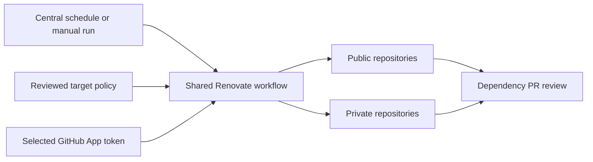

# VHCO Renovate runner

A reusable GitHub Actions workflow for owner-operated Renovate dependency updates.

One central public runner updates selected repositories through your GitHub App.
Private source stays inside the job; raw Renovate diagnostics are discarded.
Update PRs require your review, with automatic merging disabled.

The [accepted feature](docs/specs/shared-renovate-runner.md) is in progress.
Local tests include the pinned native image. Independent implementation review remains pending. Lab owns one live integration smoke after the verified first release, with private target Actions disabled.
Scheduling and release publication are disabled.

## Use and operate

- [Complete external caller example](examples/external/renovate.yml), with [trusted target policy](examples/external/config/targets.json)
- [Local verification](docs/operations.md#local-verification)
- [App access and trust](docs/operations.md#adoption-and-trust)
- [Scheduler health and recovery](docs/operations.md#scheduler-health)
- [Release verification and staged adoption](docs/operations.md#release-identity)

The component uses the shared GitVersion release workflow.
External consumers pin a verified release commit. No release has been published yet.

Licensed under [Apache-2.0](LICENSE). Copyright 2026 VH & Co BV.
